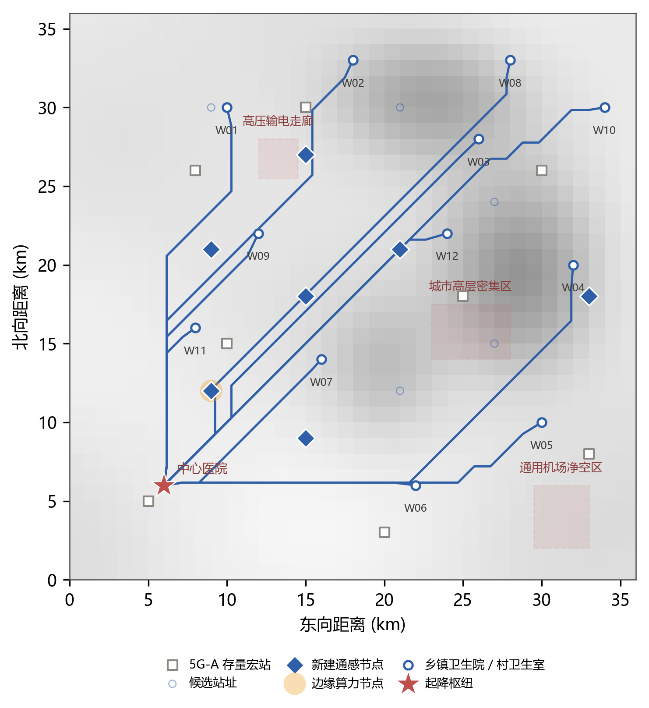

# 6G 通感算一体 · 县域低空医疗配送协同调度仿真平台



面向县域医共体低空物流的组网规划工具。用一套可复现的数值模型，回答"要布几个站、
算力放在哪、成本和时延怎么换"这三个工程问题，所有参数可调、结果可复现。

给定 36 km × 36 km 的山区县域、12 个乡镇需求点、8 座存量 5G-A 宏站和 12 个候选站址，
平台用 NSGA-II 在「时延 / 成本 / 覆盖空洞」三目标上求解，给出分三期落地的组网方案。

## 快速启动

**Windows**：双击 `启动.bat`，或在项目目录下执行：

```bash
pip install -r requirements.txt
streamlit run app.py
```

**macOS / Linux**：

```bash
python3 -m venv .venv && source .venv/bin/activate
pip install -r requirements.txt
streamlit run app.py
```

浏览器打开 http://localhost:8501 。首次加载会求解一次多目标优化（约 3 秒），之后走缓存。

## 场景与模型

**算例**：36 km × 36 km 山区县域，1 个县域中心医院起降枢纽，12 个乡镇卫生院／村卫生室，
8 座 5G-A 存量宏站，12 个候选低空通感节点站址，3 处禁飞／限飞区。

**核心建模链路**

1. **地形与视距** — 海拔场 80—500 m，飞行器离地 120 m，逐点判定视线是否被山体遮挡；
   遮挡段进入绕射区，附加损耗由 3—7 dB 跃升至 15—23 dB。
2. **上行 SINR** — 低空的真正瓶颈是同频干扰：飞行器对多站视距可见，服务小区之外的
   信号直接叠加。`SINR = S /（Σ其它站功率 × 干扰泄漏系数 + 噪声）`。
   5G-A 泄漏系数 0.22（无波束隔离），6G 通感节点 0.05（大规模阵列空间隔离）。
3. **速率与覆盖** — 香农界换算上行速率，与业务需求（5G 1080p/25 Mbps、6G 4K/100 Mbps）
   比较得出覆盖判定。
4. **通感定位精度** — 6G 节点回波感知做多站融合，精度随可融合站点数改善；
   无通感能力时退化为 GNSS 单点，山区多径误差 6—11 m。
5. **时延预算** — 空口往返 + 回传跳数×单跳时延 + 边缘推理 + 感知处理 + 抖动 P95。
6. **算力排队** — M/M/1 近似 `W = S /（1 − ρ）`，负载率逼近 1 时排队时延发散。
7. **成本** — 节点 12 万元/年、边缘算力 8 万元/年×档位系数，叠加 12% 运维，按年架次摊薄。
8. **多目标优化** — NSGA-II，决策变量为 12 位站址选择 + 12 位算力节点选择 + 算力档位，
   目标为「时延 / 成本 / 空洞率」三目标同时最小。

> 所有参数集中在 `core/config.py`，改动后界面即时重算；未标注实测的数据均为
> 依据链路预算与行业公开资料做出的工程估算，用于方案比较，不作为实测结论。

## 功能模块

| # | 模块 | 回答什么问题 |
|---|------|-------------|
| 1 | 场景总览 | 场景是什么、痛点在哪、优化在解什么 |
| 2 | 需求与 KPI | 需求来源、指标达成度、时效与成本对比 |
| 3 | 空域覆盖与通感感知 | 覆盖空洞在哪、定位精度够不够 |
| 4 | 航路规划与冲突 | 航路怎么走、绕行多少、哪里会冲突 |
| 5 | 通信—算力协同 | 时延花在哪、算力配多少才不排队 |
| 6 | 多目标优化 Pareto | 成本换性能的边界在哪、推荐哪个方案 |
| 7 | 组网模式对比 | 纯 5G / 混合 / 全量 6G，为什么选混合 |
| 8 | 敏感性分析 | 结论稳不稳、哪个因素最关键、何时该扩容 |
| 9 | 建设规划与风险 | 分几期建、每期验收条件、风险怎么应对 |
| 10 | 指标汇总与导出 | 全套指标、计算口径、适用范围、JSON/CSV 导出 |
| 11 | 数据接入 | 用自己的数据替换默认算例（模板下载 / 上传校验 / 应用重算） |

## 目录结构

```
lowairmed-6g/
├─ app.py                  入口：侧栏导航 + 全局参数 + 模块分发
├─ appkit.py               公共层：缓存入口、版本兼容、图表统一样式、通用绘图件
├─ core/
│  ├─ config.py            场景几何、需求点、组网参数、经济参数、KPI 目标
│  ├─ dataset.py           数据集接入：模板导出、上传解析、校验、应用与回滚
│  ├─ scenario.py          地形海拔场、禁飞区、A* 航路、视距矩阵
│  ├─ link.py              链路预算、SINR、覆盖、通感定位精度
│  ├─ model.py             时延预算、算力排队、成本、KPI 判定
│  ├─ nsga2.py             NSGA-II 非支配排序 + 拥挤度 + 膝点
│  ├─ sensitivity.py       单因素敏感性、三模式对比、能力对照
│  └─ policy.py            需求依据、标准衔接、三期路线图、风险、团队分工
├─ views/                  11 个功能模块，每个 render(ctx)
├─ docs/
│  ├─ gen_figures.py       正文插图的绘图脚本
│  └─ figures/             8 张插图（300 dpi）
├─ requirements.txt
└─ 启动.bat                Windows 一键启动
```

## 用自己的数据

「数据接入」模块支持把默认算例整体替换成自己的数据。四张表各自独立，可只换其中一张。

| 表 | 必需列 | 说明 |
|----|--------|------|
| 需求点 | 编号、名称、x、y、日架次、地面绕行系数 | x/y 为 km；绕行系数 ≥ 1.0，山区一般 1.5—2.5 |
| 存量基站 | 编号、x、y | 已有 5G-A 宏站，视为沉没成本 |
| 候选站址 | 编号、x、y | 优化从中选点，建议 6—30 个 |
| 禁飞区 | 名称、x0、y0、x1、y1 | 矩形，需 x0<x1、y0<y1；可为空 |

流程：**下载模板 → 按列填数 → 上传 → 校验 → 应用并重算**。

- 支持 UTF-8 编码的 CSV 与 xlsx（xlsx 需 openpyxl）；Excel 另存时选「CSV UTF-8」。
- 逐行校验：坐标越界、日架次非正、绕行系数小于 1、编号重复、缺列，都会指出具体行号并拒绝应用，不会覆盖现有数据。
- 应用后全站指标按新数据集重算；随时可「恢复默认数据」。
- 数据只存在当前会话内，刷新页面即回到默认算例（除非重新上传）。

## 侧栏参数

| 参数 | 作用 |
|------|------|
| 组网模式 | 纯 5G-A 现网 / 混合部署（默认）/ 全量升级 6G，用于控制变量对比 |
| 需求强度倍率 | 0.6—1.6，模拟季节高峰与突发公卫事件 |
| 地形遮蔽强度 | 0.6—1.5，反映山体与植被衰减的估计偏差 |
| 启用通感一体 | 关闭后退化为仅 GNSS 定位，用于对照「感知到底值多少」 |
| 种群规模 / 迭代代数 | 影响前沿密度与求解时间，默认 56×36（全站同源，见 `core/config.py` 的 `POP_SIZE` / `GENERATIONS`） |

## 推荐方案选取规则

在前沿上筛出**满足全部一期验收指标**的解，取其中**成本最低**者作为推荐方案；
若无可行解则退化为归一化膝点。规则在「多目标优化 Pareto」模块底部实时显示。

## 环境与依赖

Python 3.10 及以上。依赖清单见 [`requirements.txt`](requirements.txt)：
streamlit、numpy、pandas、plotly、matplotlib、openpyxl。

`docs/gen_figures.py` 用 matplotlib 生成正文插图，仅在需要重绘时运行，平台本身不依赖它。

## 已知边界

- 仿真为合成算例，未使用真实地形与现网工参数据；结论用于方法验证与方案比较。
- 香农界速率未叠加实际调制编码与调度开销，属上界估计；结论对相对比较成立。
- 未建模多径快衰落与雨衰，山区极端天气下的可靠性需以试点实测为准。

## 说明

本仓库只包含仿真平台的源代码与绘图脚本。配套的方案文档、演示视频与佐证材料
随赛事报名材料单独提交，不在本仓库内。

代码与文档由团队独立编写，仿真参数依据 3GPP 关于 6G 通感一体的公开研究方向、
低空经济与医疗物流的公开政策资料设定，未使用任何第三方商业软件、需授权的模型
或数据集。转载或引用请注明出处。
